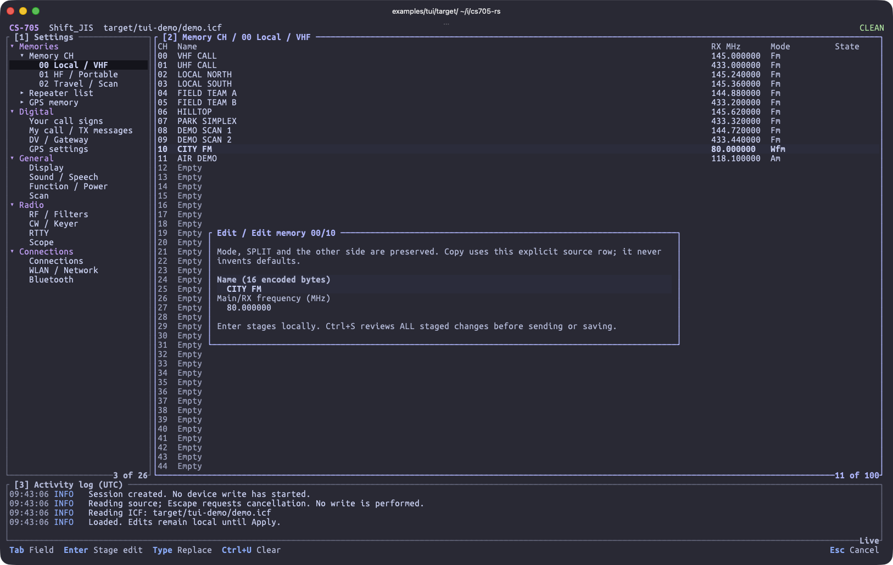

# TUI Example

A Ratatui example that edits IC-705 settings through the [`cs705`](../../README.md) library.
File mode accepts canonical MapRev 5 or 6 ICF files and does not open a serial port.

```console
$ cargo run --locked -- --help
$ cargo run --locked -- --file settings.icf --backup-dir backups
```

[](screenshot.png)

### How It Works

- [`app.rs`](src/app.rs) runs the terminal event loop and sends file/radio jobs to a single background I/O thread.
- [`model.rs`](src/model.rs) keeps the original snapshot and a local draft, using the library's memory and settings APIs.
- [`storage.rs`](src/storage.rs) checks that the input file has not changed, writes a backup, and saves a new ICF without overwriting the source.
- [`radio.rs`](src/radio.rs) uses library clone sessions with a fresh-read conflict check and a pre-write backup.
  Writes are not retried automatically.

